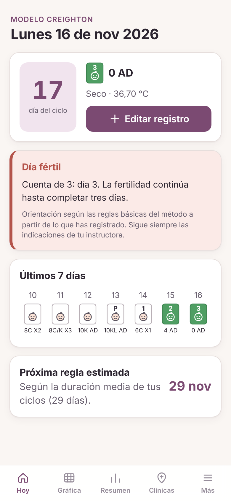
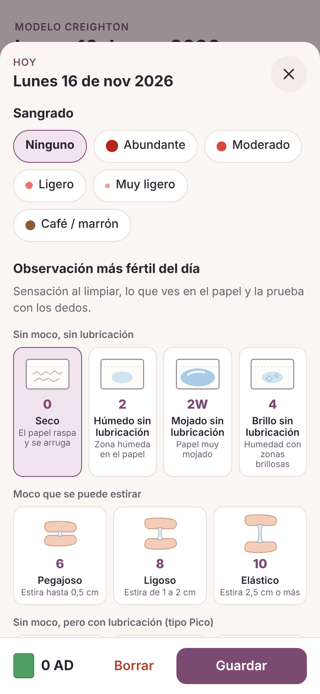

# Aurora — tu ciclo, naturalmente

App móvil (PWA) para que una mujer registre su ciclo con el **método natural que ella elija**:

| Método | Qué se registra | Qué calcula la app |
|---|---|---|
| **Modelo Creighton** | Sangrado (H, M, L, VL, B), observación (0, 2, 2W, 4, 6, 8, 10, 10DL/SL/WL), color y consistencia (K, C, C/K, Y, B, R, P, G, L), frecuencia (X1, X2, X3, AD) | Código del día (`10KL AD`), estampas, día Pico (P) y cuenta 1‑2‑3 |
| **Billings** | Sensación en la vulva y apariencia del moco | Estampas, día Cúspide y cuenta 1‑2‑3 |
| **Sintotérmico** | Temperatura basal + moco | Subida de temperatura («3 sobre 6»), línea base, Pico + 3 |
| **Temperatura basal** | Temperatura al despertar | Subida de temperatura y línea base |
| **Calendario** | Inicio y días de regla | Duración de ciclos, ventana fértil estimada, próxima regla |

Además:

- **Guía visual** para el registro: dibujos de cada observación y tabla de colores del moco.
- **Gráfica** por ciclos al estilo de la hoja Creighton (toca un día para editarlo) y curva de temperatura.
- **Resumen**: duración media, ciclo más corto/largo, día Pico medio, fase post‑Pico.
- **Descarga en Excel y PDF** para llevar a la instructora o al médico.
- **Clínicas y contactos** de naprotecnología por país (`src/data/clinics.ts`).
- **Privacidad**: todo se guarda solo en el dispositivo (localStorage). Sin cuentas ni servidor. Copia de seguridad en JSON.

 

## Desarrollo

```bash
npm install
npm run dev      # servidor local
npm test         # pruebas de las reglas (Pico, cuenta de 3, temperatura…)
npm run build    # compila a dist/ (sitio estático, instalable como PWA)
```

Estructura:

- `src/lib/engine.ts` — reglas: ciclos, clasificación del día, Pico, cuenta de 3, subida de temperatura, calendario.
- `src/lib/methods.ts` — definición de los métodos y sus códigos.
- `src/components/EntrySheet.tsx` — formulario del día. `src/components/art.tsx` — estampas, dibujos y colores.
- `src/screens/` — Hoy, Gráfica, Resumen, Clínicas, Más. `src/lib/export.ts` — Excel y PDF.

Para añadir una clínica, copia un bloque en `src/data/clinics.ts` (y el país en `COUNTRIES` si es nuevo).

## Avisos

Aurora es un cuaderno de registro: no es un producto sanitario ni sustituye a la instructora o al médico.
CREIGHTON MODEL FertilityCare™ System y NaProTECHNOLOGY® son marcas del Saint Paul VI Institute; Billings Ovulation Method® es marca de WOOMB International. Este proyecto es independiente y no está afiliado a ellas.
